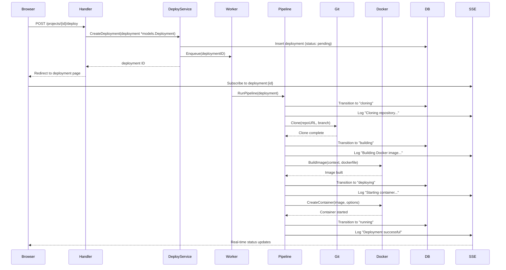
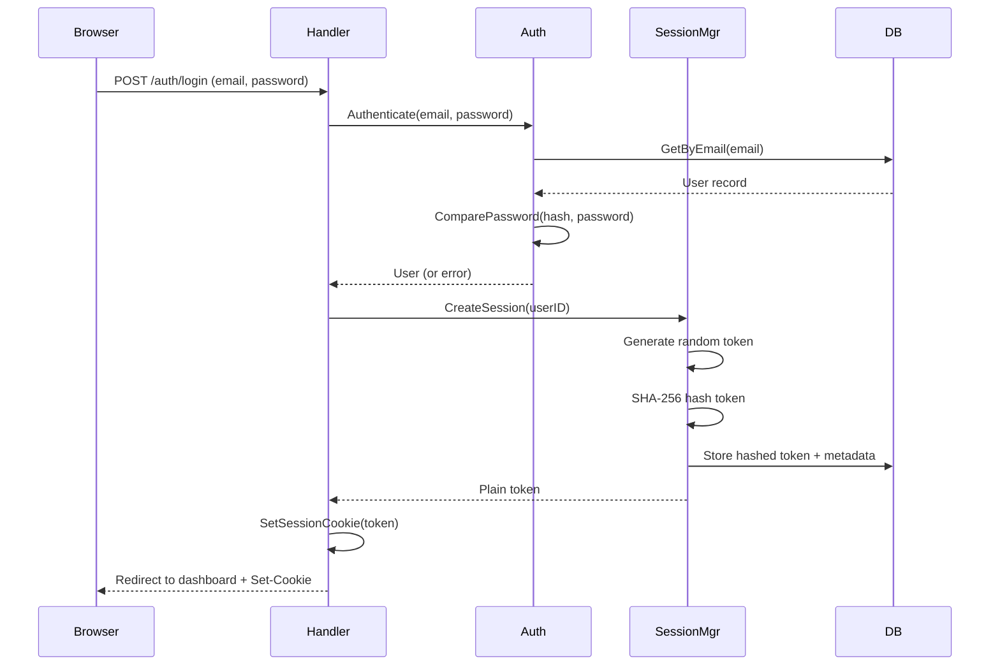
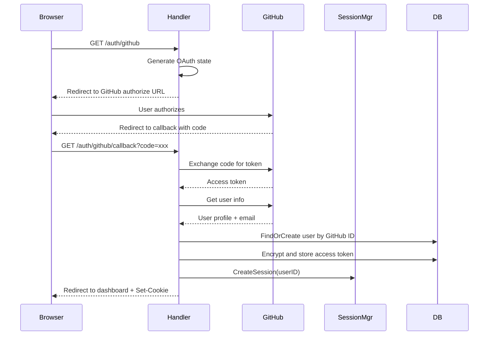
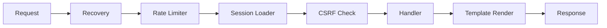
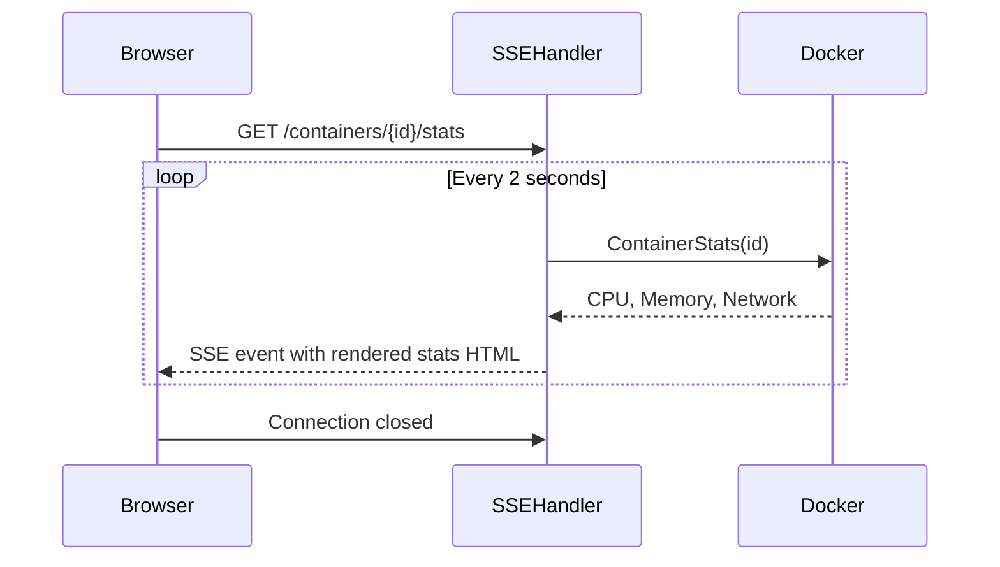
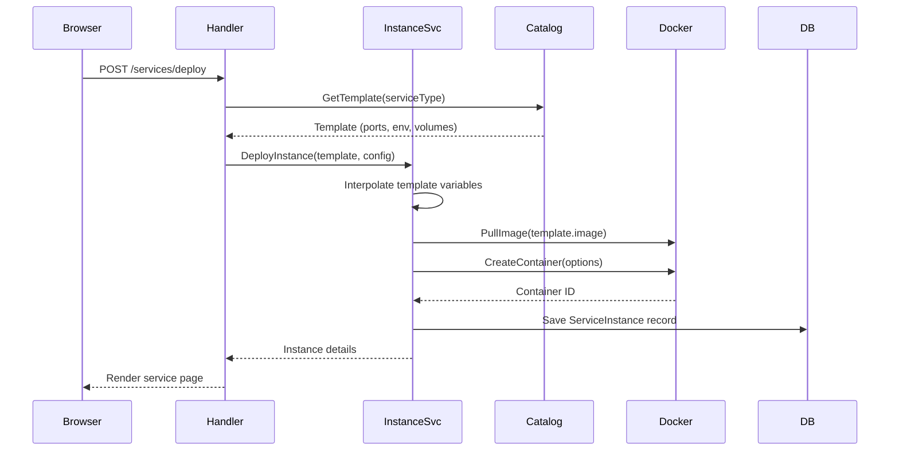
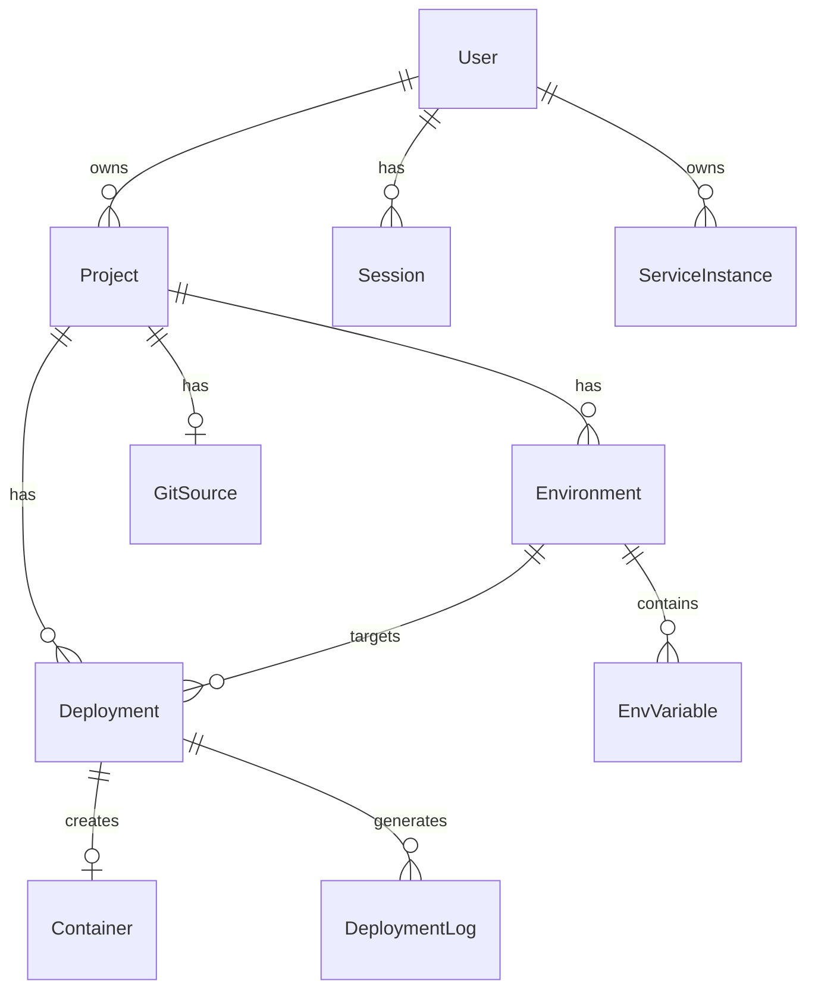

# Data Flow

This page traces the flow of data through GoForge for key operations.

## Deployment Flow

When a user triggers a deployment, data flows through these components:

## Authentication Flow

### Local Login

### GitHub OAuth

## Request Middleware Chain

Every HTTP request passes through middleware in this order:

## Real-Time Data (SSE)

Container stats and deployment logs stream to the browser via SSE:

!!! note
    Container stats are polled directly by the SSE handler every 2 seconds and do not flow through the SSE Hub. The handler renders stats as HTML (using templ components) and streams them directly to the client.

## Service Deployment Flow

One-click services follow a template-based deployment:

## Database Entity Relationships

