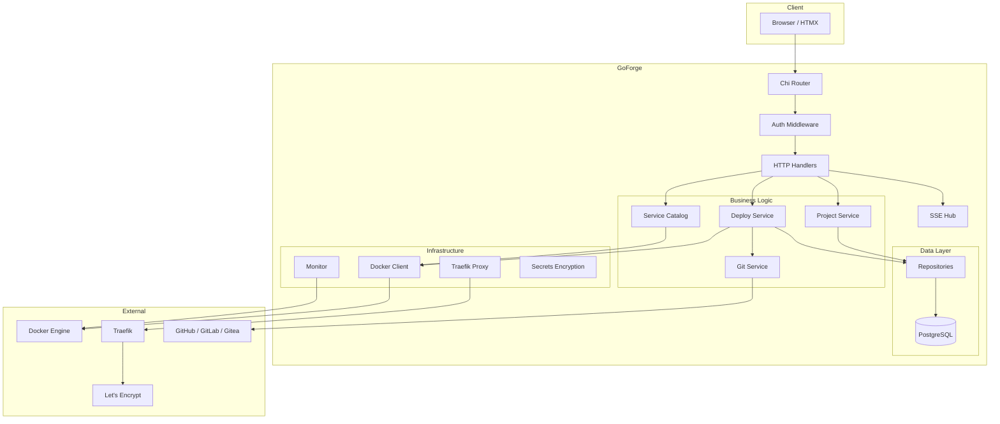
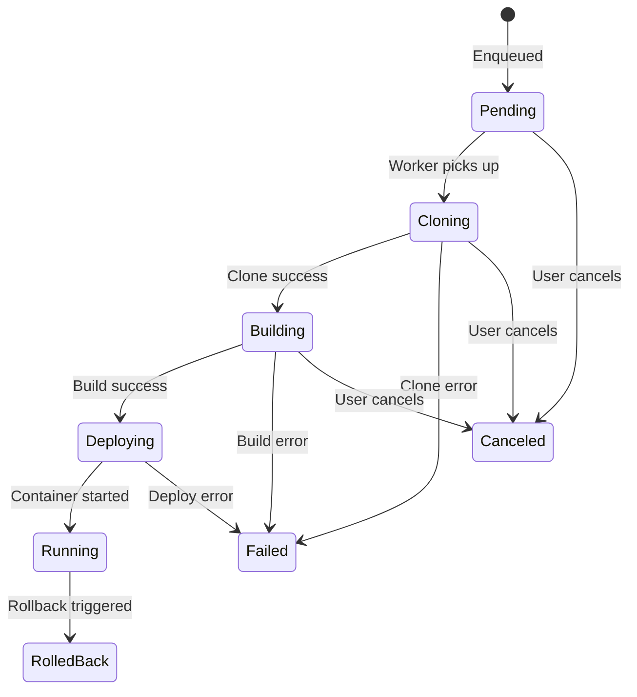

# Architecture Overview

GoForge follows a clean, layered architecture that separates concerns across well-defined internal packages. This page provides a high-level view of how the system is organized and how components interact.

## System Architecture



## Layers

### 1. HTTP Layer (Presentation)

- **Router** (`internal/web/router.go`) -- Chi-based HTTP router with middleware chain
- **Handlers** (`internal/web/handlers/`) -- Thin HTTP handlers that parse requests, call services, and render responses
- **Templates** (`internal/web/templates/`) -- templ-based server-side templates with HTMX integration. Pages are built from the UI kit in `components/ui` (see [UI kit](../reference/ui-kit.md))
- **Middleware** -- Authentication, CSRF protection, rate limiting, logging

### 2. Service Layer (Business Logic)

- **Project Service** (`internal/project/`) -- Project and environment lifecycle management
- **Deploy Service** (`internal/deploy/`) -- Deployment pipeline orchestration with state machine
- **Git Service** (`internal/git/`) -- Multi-provider Git operations (clone, pull, webhooks)
- **Service Catalog** (`internal/services/`) -- One-click service template management

### 3. Infrastructure Layer

- **Docker Client** (`internal/docker/`) -- Docker SDK wrapper for image builds, container lifecycle, logs, and system prune
- **Proxy Manager** (`internal/proxy/`) -- Traefik label generation with middleware support
- **Monitor** (`internal/monitor/`) -- Real-time container metrics collection from Docker stats API
- **Secrets** (`internal/secrets/`) -- AES-256-GCM encryption for sensitive data at rest
- **SSE Hub** (`internal/sse/`) -- Server-Sent Events pub/sub for real-time updates

### 4. Data Layer

- **Repositories** (`internal/database/repositories/`) -- PostgreSQL data access using the repository pattern
- **Models** (`internal/models/`) -- Domain model definitions
- **Migrations** (`internal/database/migrations/`) -- SQL schema migrations managed by golang-migrate

## Request Flow

A typical request flows through these layers:

```
Browser Request
  -> Chi Router (route matching)
    -> Rate Limiter Middleware
      -> Session Middleware (load user from cookie)
        -> CSRF Middleware (validate token)
          -> Handler (parse request, validate input)
            -> Service (business logic, authorization)
              -> Repository (database query)
              -> Docker Client (container operations)
            <- Service returns result
          <- Handler renders templ template
        <- CSRF token injected
      <- Session cookie set
    <- Rate limit headers set
  <- HTML response with HTMX attributes
```

## Deployment Pipeline

The deployment process follows a defined state machine:



## Key Technologies

| Component | Technology | Purpose |
|-----------|-----------|---------|
| Language | Go 1.26 | Backend, CLI, all server-side logic |
| Router | go-chi/chi/v5 | HTTP routing and middleware |
| Templates | a-h/templ | Type-safe server-side HTML templates |
| Frontend | HTMX 2 | Dynamic UI without JavaScript frameworks |
| Styling | TailwindCSS 3.4.17 | Utility-first CSS, with design tokens as CSS variables in `static/css/input.css` |
| Database | PostgreSQL | Primary data store |
| Docker | Docker SDK | Container management |
| Git | go-git/v5 | Git clone/pull operations |
| Auth | golang.org/x/crypto | Argon2id password hashing |
| OAuth | golang.org/x/oauth2 | GitHub OAuth flow |
| CLI | spf13/cobra | Command-line interface |
| Migrations | golang-migrate/v4 | Database schema management |
