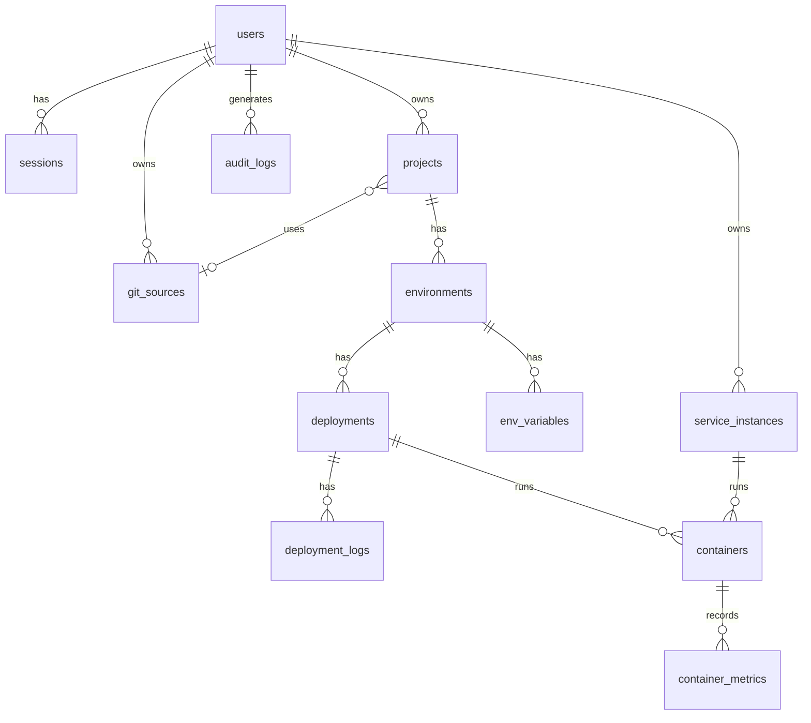

# Database Schema Reference

GoForge uses PostgreSQL with UUID primary keys (via the `uuid-ossp` extension). All tables use `TIMESTAMPTZ` for timestamps.

Migrations are located in `internal/database/migrations/postgres/` and are applied in order (001-011).

---

## Entity Relationship Overview



---

## Tables

### users

Stores user accounts. Supports both email/password and GitHub OAuth authentication.

| Column | Type | Constraints | Description |
|--------|------|-------------|-------------|
| `id` | `UUID` | PK, default `uuid_generate_v4()` | Unique identifier |
| `email` | `VARCHAR(255)` | UNIQUE, NOT NULL | User email address |
| `password_hash` | `VARCHAR(255)` | Nullable | Argon2id hash (null for OAuth-only users) |
| `github_id` | `BIGINT` | UNIQUE, nullable | GitHub user ID |
| `github_username` | `VARCHAR(255)` | Nullable | GitHub username |
| `github_access_token` | `TEXT` | Nullable | GitHub OAuth access token |
| `avatar_url` | `TEXT` | Nullable | Profile avatar URL |
| `created_at` | `TIMESTAMPTZ` | Default `NOW()` | Account creation time |
| `updated_at` | `TIMESTAMPTZ` | Default `NOW()` | Last update time |

**Indexes**: `idx_users_email` (email), `idx_users_github_id` (github_id)

**Migration**: `001_create_users`

---

### sessions

Stores authenticated user sessions. Tokens are hashed (SHA-256) before storage.

| Column | Type | Constraints | Description |
|--------|------|-------------|-------------|
| `id` | `UUID` | PK, default `uuid_generate_v4()` | Unique identifier |
| `user_id` | `UUID` | FK -> users(id) ON DELETE CASCADE | Session owner |
| `token_hash` | `VARCHAR(64)` | UNIQUE, NOT NULL | SHA-256 hash of session token |
| `expires_at` | `TIMESTAMPTZ` | NOT NULL | Session expiration |
| `created_at` | `TIMESTAMPTZ` | Default `NOW()` | Session creation time |
| `last_active_at` | `TIMESTAMPTZ` | Default `NOW()` | Last activity timestamp |

**Indexes**: `idx_sessions_user_id` (user_id), `idx_sessions_token_hash` (token_hash), `idx_sessions_expires_at` (expires_at)

**Migration**: `002_create_sessions`

---

### git_sources

Configured git providers (GitHub, GitLab, Gitea, or raw SSH).

| Column | Type | Constraints | Description |
|--------|------|-------------|-------------|
| `id` | `UUID` | PK, default `uuid_generate_v4()` | Unique identifier |
| `user_id` | `UUID` | FK -> users(id) ON DELETE CASCADE | Owner |
| `name` | `VARCHAR(255)` | NOT NULL | Display name |
| `type` | `VARCHAR(50)` | NOT NULL, CHECK IN ('github','gitlab','gitea','ssh') | Provider type |
| `api_url` | `TEXT` | Nullable | API base URL (for self-hosted instances) |
| `access_token` | `TEXT` | Nullable | API access token |
| `ssh_private_key` | `TEXT` | Nullable | SSH private key (for SSH type) |
| `is_default` | `BOOLEAN` | Default `FALSE` | Whether this is the default source |
| `created_at` | `TIMESTAMPTZ` | Default `NOW()` | Creation time |
| `updated_at` | `TIMESTAMPTZ` | Default `NOW()` | Last update time |

**Indexes**: `idx_git_sources_user_id` (user_id)

**Migration**: `003_create_git_sources`

!!! info "Security Note"
    The `access_token` and `ssh_private_key` columns are encrypted at the application level using the `internal/secrets` package before storage.

---

### projects

Application projects linked to a git repository.

| Column | Type | Constraints | Description |
|--------|------|-------------|-------------|
| `id` | `UUID` | PK, default `uuid_generate_v4()` | Unique identifier |
| `user_id` | `UUID` | FK -> users(id) ON DELETE CASCADE | Project owner |
| `name` | `VARCHAR(255)` | NOT NULL | Project name |
| `description` | `TEXT` | Nullable | Project description |
| `git_source_id` | `UUID` | FK -> git_sources(id) ON DELETE SET NULL | Linked git source |
| `repository_url` | `TEXT` | NOT NULL | Git repository URL |
| `repository_name` | `VARCHAR(255)` | Nullable | Repository display name |
| `default_branch` | `VARCHAR(255)` | Default `'main'` | Default branch to deploy |
| `dockerfile_path` | `VARCHAR(255)` | Default `'Dockerfile'` | Path to Dockerfile |
| `docker_compose_path` | `VARCHAR(255)` | Nullable | Path to Docker Compose file |
| `build_context` | `VARCHAR(255)` | Default `'.'` | Docker build context directory |
| `build_args` | `JSONB` | Default `'{}'` | Docker build arguments |
| `health_check_path` | `VARCHAR(255)` | Default `'/'` | HTTP health check endpoint |
| `health_check_interval` | `INTEGER` | Default `30` | Health check interval (seconds) |
| `auto_deploy` | `BOOLEAN` | Default `TRUE` | Auto-deploy on git push |
| `custom_domain` | `VARCHAR(255)` | Nullable | Custom domain (added in migration 011) |
| `created_at` | `TIMESTAMPTZ` | Default `NOW()` | Creation time |
| `updated_at` | `TIMESTAMPTZ` | Default `NOW()` | Last update time |

**Indexes**: `idx_projects_user_id` (user_id), `idx_projects_git_source_id` (git_source_id)

**Migrations**: `004_create_projects`, `011_add_custom_domain_to_projects`

---

### environments

Deployment environments within a project (e.g., production, staging).

| Column | Type | Constraints | Description |
|--------|------|-------------|-------------|
| `id` | `UUID` | PK, default `uuid_generate_v4()` | Unique identifier |
| `project_id` | `UUID` | FK -> projects(id) ON DELETE CASCADE | Parent project |
| `name` | `VARCHAR(50)` | NOT NULL, UNIQUE(project_id, name) | Environment name |
| `domain` | `VARCHAR(255)` | Nullable | Assigned domain |
| `port` | `INTEGER` | Nullable | Application port |
| `branch` | `VARCHAR(255)` | Nullable | Git branch to deploy |
| `replicas` | `INTEGER` | Default `1` | Number of container replicas |
| `cpu_limit` | `VARCHAR(20)` | Nullable | CPU limit (Docker format) |
| `memory_limit` | `VARCHAR(20)` | Nullable | Memory limit (Docker format) |
| `auto_deploy` | `BOOLEAN` | Default `TRUE` | Auto-deploy on push |
| `created_at` | `TIMESTAMPTZ` | Default `NOW()` | Creation time |
| `updated_at` | `TIMESTAMPTZ` | Default `NOW()` | Last update time |

**Indexes**: `idx_environments_project_id` (project_id), `idx_environments_domain` (domain)

**Migration**: `005_create_environments`

---

### env_variables

Environment variables injected into containers at deploy time.

| Column | Type | Constraints | Description |
|--------|------|-------------|-------------|
| `id` | `UUID` | PK, default `uuid_generate_v4()` | Unique identifier |
| `environment_id` | `UUID` | FK -> environments(id) ON DELETE CASCADE | Parent environment |
| `key` | `VARCHAR(255)` | NOT NULL, UNIQUE(environment_id, key) | Variable name |
| `value` | `TEXT` | NOT NULL | Variable value |
| `is_secret` | `BOOLEAN` | Default `FALSE` | Marks as secret (UI masking only) |
| `created_at` | `TIMESTAMPTZ` | Default `NOW()` | Creation time |
| `updated_at` | `TIMESTAMPTZ` | Default `NOW()` | Last update time |

**Indexes**: `idx_env_variables_environment_id` (environment_id)

**Migration**: `006_create_env_variables`

!!! info "Security Note"
    Secret values (where `is_secret` is `TRUE`) are encrypted at the application level using the `internal/secrets` package. The `is_secret` flag also controls UI display masking.

---

### deployments

Records of each deployment attempt.

| Column | Type | Constraints | Description |
|--------|------|-------------|-------------|
| `id` | `UUID` | PK, default `uuid_generate_v4()` | Unique identifier |
| `environment_id` | `UUID` | FK -> environments(id) ON DELETE CASCADE | Target environment |
| `status` | `VARCHAR(50)` | NOT NULL, CHECK, default `'pending'` | Current status |
| `trigger_type` | `VARCHAR(50)` | NOT NULL, CHECK, default `'manual'` | How deployment was triggered |
| `commit_sha` | `VARCHAR(40)` | Nullable | Git commit SHA |
| `commit_message` | `TEXT` | Nullable | Git commit message |
| `commit_author` | `VARCHAR(255)` | Nullable | Git commit author |
| `branch` | `VARCHAR(255)` | Nullable | Git branch deployed |
| `image_tag` | `VARCHAR(255)` | Nullable | Docker image tag built |
| `error_message` | `TEXT` | Nullable | Error details on failure |
| `started_at` | `TIMESTAMPTZ` | Nullable | When deployment execution began |
| `finished_at` | `TIMESTAMPTZ` | Nullable | When deployment completed |
| `created_at` | `TIMESTAMPTZ` | Default `NOW()` | Record creation time |

**Status values**: `pending`, `cloning`, `building`, `deploying`, `running`, `failed`, `rolled_back`, `canceled`

**Trigger types**: `manual`, `webhook`, `rollback`

**Indexes**: `idx_deployments_environment_id` (environment_id), `idx_deployments_status` (status), `idx_deployments_created_at` (created_at DESC)

**Migration**: `007_create_deployments`

---

### deployment_logs

Structured log entries for each deployment (build output, deploy steps).

| Column | Type | Constraints | Description |
|--------|------|-------------|-------------|
| `id` | `UUID` | PK, default `uuid_generate_v4()` | Unique identifier |
| `deployment_id` | `UUID` | FK -> deployments(id) ON DELETE CASCADE | Parent deployment |
| `timestamp` | `TIMESTAMPTZ` | Default `NOW()` | Log entry time |
| `level` | `VARCHAR(20)` | CHECK, default `'info'` | Log level |
| `message` | `TEXT` | NOT NULL | Log message content |
| `source` | `VARCHAR(50)` | Nullable | Log source (e.g., `build`, `deploy`) |

**Log levels**: `debug`, `info`, `warn`, `error`

**Indexes**: `idx_deployment_logs_deployment_id` (deployment_id), `idx_deployment_logs_timestamp` (deployment_id, timestamp)

**Migration**: `007_create_deployments`

---

### service_instances

One-click service instances (PostgreSQL, Redis, etc.) deployed from templates.

| Column | Type | Constraints | Description |
|--------|------|-------------|-------------|
| `id` | `UUID` | PK, default `uuid_generate_v4()` | Unique identifier |
| `user_id` | `UUID` | FK -> users(id) ON DELETE CASCADE | Owner |
| `template_name` | `VARCHAR(100)` | NOT NULL | Template used (e.g., `postgres`) |
| `name` | `VARCHAR(255)` | NOT NULL | Instance display name |
| `version` | `VARCHAR(50)` | Nullable | Version deployed |
| `config` | `JSONB` | Default `'{}'` | Configuration values. Encrypted as `{"_goforge_enc":"..."}` when an encryption key is configured |
| `domain` | `VARCHAR(255)` | Nullable | Assigned domain |
| `status` | `VARCHAR(50)` | NOT NULL, CHECK, default `'pending'` | Instance status |
| `connection_info` | `JSONB` | Default `'{}'` | Connection strings/details, encrypted the same way as `config` |
| `created_at` | `TIMESTAMPTZ` | Default `NOW()` | Creation time |
| `updated_at` | `TIMESTAMPTZ` | Default `NOW()` | Last update time |

**Status values**: `pending`, `starting`, `running`, `stopped`, `failed`

**Indexes**: `idx_service_instances_user_id` (user_id), `idx_service_instances_template_name` (template_name)

**Migration**: `008_create_service_instances`

---

### containers

Tracks Docker containers for both deployments and service instances.

| Column | Type | Constraints | Description |
|--------|------|-------------|-------------|
| `id` | `UUID` | PK, default `uuid_generate_v4()` | Unique identifier |
| `deployment_id` | `UUID` | FK -> deployments(id) ON DELETE SET NULL | Deployment (nullable) |
| `service_instance_id` | `UUID` | FK -> service_instances(id) ON DELETE SET NULL | Service instance (nullable) |
| `docker_id` | `VARCHAR(64)` | NOT NULL | Docker container ID |
| `name` | `VARCHAR(255)` | NOT NULL | Container name |
| `image` | `VARCHAR(255)` | NOT NULL | Docker image used |
| `status` | `VARCHAR(50)` | NOT NULL | Container status |
| `ports` | `JSONB` | Default `'[]'` | Port mappings |
| `labels` | `JSONB` | Default `'{}'` | Docker labels |
| `created_at` | `TIMESTAMPTZ` | Default `NOW()` | Creation time |
| `updated_at` | `TIMESTAMPTZ` | Default `NOW()` | Last update time |

**Indexes**: `idx_containers_deployment_id` (deployment_id), `idx_containers_service_instance_id` (service_instance_id), `idx_containers_docker_id` (docker_id)

**Migration**: `009_create_containers`

!!! note
    A container belongs to either a deployment OR a service instance, but not both. Both foreign keys are nullable with `ON DELETE SET NULL` to preserve container records after their parent is deleted.

---

### container_metrics

Time-series metrics for container resource usage.

| Column | Type | Constraints | Description |
|--------|------|-------------|-------------|
| `id` | `UUID` | PK, default `uuid_generate_v4()` | Unique identifier |
| `container_id` | `UUID` | FK -> containers(id) ON DELETE CASCADE | Parent container |
| `timestamp` | `TIMESTAMPTZ` | Default `NOW()` | Measurement time |
| `cpu_percent` | `DECIMAL(5,2)` | Nullable | CPU usage percentage |
| `memory_usage` | `BIGINT` | Nullable | Memory usage (bytes) |
| `memory_limit` | `BIGINT` | Nullable | Memory limit (bytes) |
| `memory_percent` | `DECIMAL(5,2)` | Nullable | Memory usage percentage |
| `network_rx` | `BIGINT` | Nullable | Network bytes received |
| `network_tx` | `BIGINT` | Nullable | Network bytes transmitted |
| `block_read` | `BIGINT` | Nullable | Disk bytes read |
| `block_write` | `BIGINT` | Nullable | Disk bytes written |

**Indexes**: `idx_container_metrics_container_timestamp` (container_id, timestamp DESC)

**Migration**: `009_create_containers`

---

### audit_logs

Tracks user actions for auditing and compliance.

| Column | Type | Constraints | Description |
|--------|------|-------------|-------------|
| `id` | `UUID` | PK, default `uuid_generate_v4()` | Unique identifier |
| `user_id` | `UUID` | FK -> users(id) ON DELETE SET NULL | Acting user (nullable) |
| `action` | `VARCHAR(100)` | NOT NULL | Action performed |
| `resource_type` | `VARCHAR(50)` | NOT NULL | Resource type affected |
| `resource_id` | `UUID` | Nullable | Resource identifier |
| `details` | `JSONB` | Default `'{}'` | Additional details |
| `ip_address` | `INET` | Nullable | Client IP address |
| `user_agent` | `TEXT` | Nullable | Client user agent |
| `created_at` | `TIMESTAMPTZ` | Default `NOW()` | Action timestamp |

**Indexes**: `idx_audit_logs_user_id` (user_id), `idx_audit_logs_resource` (resource_type, resource_id), `idx_audit_logs_created_at` (created_at DESC)

**Migration**: `010_create_audit_logs`

---

## Database Functions

### cleanup_old_data()

Defined in migration `010_create_audit_logs`. Removes stale data:

- **Container metrics** older than 7 days
- **Deployment logs** older than 30 days

```sql
SELECT cleanup_old_data();
```

This function should be called periodically via `pg_cron` or an external scheduler.

---

## Migration History

| # | Name | Description |
|---|------|-------------|
| 001 | `create_users` | Users table with email/password and GitHub OAuth fields |
| 002 | `create_sessions` | Session management with hashed tokens |
| 003 | `create_git_sources` | Git provider configurations |
| 004 | `create_projects` | Projects with build configuration |
| 005 | `create_environments` | Per-project deployment environments |
| 006 | `create_env_variables` | Environment variables per environment |
| 007 | `create_deployments` | Deployments and deployment logs |
| 008 | `create_service_instances` | One-click service instances |
| 009 | `create_containers` | Containers and container metrics |
| 010 | `create_audit_logs` | Audit trail and cleanup function |
| 011 | `add_custom_domain_to_projects` | Custom domain support for projects |
| 012 | `create_project_service_instances` | Links projects to one-click services |
| 013 | `create_api_tokens` | Personal API tokens |
| 014 | `create_deployment_queue` | Persistent deployment queue |
| 015 | `deployment_status_canceled` | Status check uses `canceled` |

All migrations have corresponding `.down.sql` files for rollback support.
